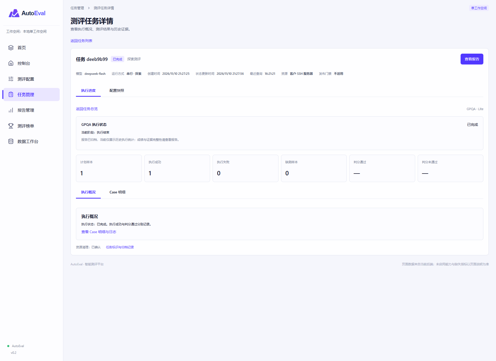

# AutoEval Demo

<p align="center">
  
</p>

AutoEval 是单团队、单工作空间的测评平台。当前实现以 GPQA Lite 探索测评为主线：模型服务 → 配置版本与确定性清单 → Docker/客户 SSH 执行 → case 历史 → 报告、分析与内部榜单。极光是独立资源提供方，不约束本平台技术栈。

前端采用 React、TypeScript、Vite；后端采用 FastAPI、Temporal、PostgreSQL 和 S3 兼容对象存储。当前为受控开发环境，正式 Release 和生产验收尚未完成。

## 当前开发状态

更新日期：2026-11-11。

| 模块 | 已实现与验证 | 主要剩余边界 |
| --- | --- | --- |
| 模型与配置 | 模型/端点登记、默认配置、版本保存、Profile 与 Full/Lite 清单绑定、分页 | 正式批准输入与其他工具流程 |
| 资源与执行 | 本机 Docker、SSH/SFTP、批准指纹、资源工具版本固定、Temporal/Outbox、取消及查证恢复 | 客户生产环境验收；极光仅保留适配契约 |
| 历史与报告 | 每次 case 尝试、只读快照、原始证据校验、完整/部分/失败摘要、基准比较 | 两份历史真实报告原文已丢失且无法恢复，索引保留并隔离 |
| 分析与榜单 | 独立分析与重试；报告提名评审、外部及官方成绩录入、按来源与条件分组、历史审计 | 真实分析需独立目标、资源及预算；正式发布门禁未实现 |
| 工具适配 | GPQA Lite 探索闭环；MMMU-Pro 原生加载/评分及工具层桥接已有实现 | MMMU-Pro 平台闭环、AutomationBench；不以工具层测试替代端到端验收 |
| 开发运维 | 持久化 MinIO、逐对象校验迁移、容器重启读回、受保护备份、SSH 重启恢复 | 生产身份、部署、存储耐久性与运维验收 |

当前任务入口仅支持已校验的 GPQA 单数据集 Lite 探索路径，每次最多5个样本、每样本最多64输出 tokens；提交会调用真实模型，不会自动重测。自定义/Lite 不产生正式 Release 通过结论。性能测评未接入，不展示为真实性能结论。

## 本机启动

工作目录采用以下结构：

```text
frontend/   React 页面、组件与 API 客户端
backend/    FastAPI、Worker、数据库迁移、工具适配与测试
deploy/    开发容器与 SSH 模拟器配置
docs/      开发计划、接入说明、验收与恢复记录
```

### 1. 基础服务与持久化存储

数据库、Temporal、执行器及已登记资源须先就绪。业务证据使用[持久化存储与恢复指南](./docs/development-recovery.md)，不能使用重启即丢失状态的 Moto 模拟器。

在仓库根目录执行，先在受保护配置中设置一致的 S3 凭据：

```powershell
docker volume create autoeval-evidence-persistent
docker compose --env-file backend/.env -fdeploy/compose.storage-durable.yaml up -d
```

开发存储使用固定摘要的 GHCR 社区 MinIO 备份镜像，主机端点为 `http://127.0.0.1:9002`，独立持久卷为 `autoeval-evidence-persistent`。来源、版本及回退步骤见恢复指南；不视为官方签名或生产安全验收。原基础 Compose 的 Moto 仅供协议测试。

### 2. API 与后台进程

```powershell
cd backend
uv sync --frozen --python 3.12
# 首次配置时从.env.example建立.env；已有配置不要覆盖。
# 设置数据库、Temporal及AE_S3_ENDPOINT=http://127.0.0.1:9002。
uv run alembic upgrade head
uv run python -m autoeval.bootstrap storage
uv run uvicorn autoeval.api:app --host 127.0.0.1 --port 8000
```

独立终端均在 backend 目录运行：

```powershell
uv run python -m autoeval.dispatcher
uv run python -m autoeval.worker workflow
uv run python -m autoeval.worker io
uv run python -m autoeval.worker gpqa
uv run python -m autoeval.reconciler
```

每条常驻命令使用独立终端。分析 Worker 仅在分析目标、资源及预算明确后开启。更多说明见[后端 README](./backend/README.md)。

### 3. 前端

准备 Node.js 22 或更高版本：

```powershell
cd frontend
npm ci
npm run dev
```

前端 `http://127.0.0.1:5173`，通过 Vite 代理访问 API；API 文档 `http://127.0.0.1:8000/docs`。`/health/live` 检查存活，`/health/ready` 检查数据库、Temporal 和对象存储。

## 页面与业务流程

- 控制台保留模型接入、配置、数据集和右侧摘要；管理能力通过表单旁抽屉进入。提交前检查模型列表、资源及配置，确认范围后提交；预检不发送生成请求。
- 已保存服务可加载模型默认配置，保存配置生成新版本。任务与报告沿用“总览 → 数据集详情 → Case / 证据”路径。
- `#run/<UUID>` 可直达任务，刷新恢复上下文；任务冻结参数与历史记录不随当前默认配置更新。
- 报告可回溯来源任务、case 的每次尝试与证据。失败历史不因重试成功而覆盖。
- `validity` 表示历史执行完整性，`evidence_status` 表示当前报告证据状态。缺失、不可用或校验失败的证据不作为有效成绩，不计算基准差值，不参与榜单；不补零或伪造成绩。
- 报告总览增加准确率与基线对比图、百分点差异及基线版本；缺失证据或不可比时不绘制虚假数值。性能区域暂显示未采集说明，尚无吞吐量、延迟及性能基线。
- 开发模式新增 `#data-workbench` 数据工作台：报告提名、评审批准 / 驳回、撤回与修改、人工及官方来源录入、JSON 批量导入。榜单支持非报告成绩，按来源和条件独立分组；原自动报告排名作为未人工评审的候选成绩保留。
- Docker 诊断集中至数据工作台。生产前端不包含工作台和诊断控件；维护 API 同样限制在 development/test。当前本地操作员自审不等同于生产审批或正式门禁。
- 空输出、截断等诊断保持原生评分规则，不能由平台擅自改判。缺测、执行失败、评分失败和不可比须分别展示。

## 验证状态

2026-11-11 收口修复后全量回归 **228 项通过，无跳过**，用时342.75秒；TypeScript、Vite 构建与 Ruff 通过。该次回归对应迁移 `0021`；当前新增榜单维护迁移 `0022_leaderboard_curation`。84个现存对象完成迁移、逐对象校验及容器重启后读回。

随后页面与数据工作台增量验证：TypeScript、Vite 和修改文件 Ruff 通过；新增工作台与已有恢复测试合计 **17 项通过**，其中维护事务使用真实 PostgreSQL。浏览器检查原页面路径、报告图表边界和工作台页签；预检及图表数值场景使用模拟响应，不代替真实测评验收。本轮未重跑上述 228 项全量回归。

两份历史真实报告的原始证据没有备份，无法恢复；当前保留历史索引并明确隔离。本轮真实报告页面验证缺失保护分支，不能将回归通过解释为历史数据恢复、新真实测评或生产验收。模型边界替身测试不产生真实榜单成绩。

```powershell
# frontend目录
npm run typecheck
npm run build
# backend目录
uv run ruff check .
uv run pytest -q
```

默认 pytest 会跳过依赖外部环境的专项，不能代替启用联调开关的全量验证。详见[收口验证记录](./docs/validation-2026-11-11.md)、[开发计划](./docs/backend-development-plan.md)及[恢复指南](./docs/development-recovery.md)。

依赖、构建产物、凭据、.env、本地备份和分享包不提交 Git。密码、私钥和 API Key 仅由后台受保护配置管理，不进入前端存储、运行快照或普通日志。

## 历史页面预览

以下截图保留早期原型的视觉参考，图中数据为示例，不代表当前后台事实或已验证测评结果。当前功能以实际页面和下述验证记录为准。

### 首页

> 首页截图已更新，展示精度测评演示范围与性能测评示意说明。首页截图尺寸为 1920 × 1500。


### 控制台


### 测试配置


### 自定义配置维护


### 任务管理


### 任务总览


### 数据集执行详情



### 报告管理


### 报告总览


### 数据集报告详情


### 测评榜单


## 开发数据工作台

开发环境新增“数据工作台”菜单，支持报告提名与评审、外部榜单成绩维护、官方 JSON 快照导入和环境诊断。榜单不要求全部来源于报告；不同来源与比较条件独立分组。使用前应用数据库迁移至 `0022_leaderboard_curation`，详见 [使用与接口说明](./docs/data-workbench.md)。尚未对接官网自动同步。
