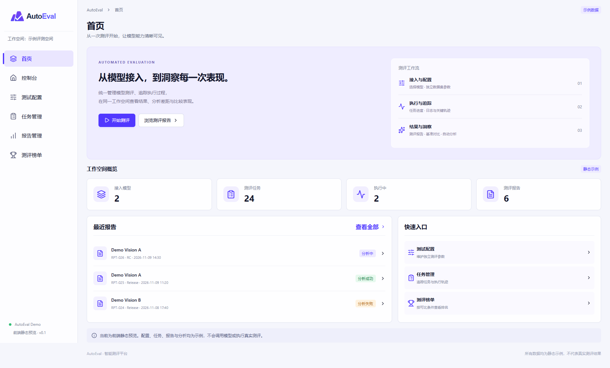
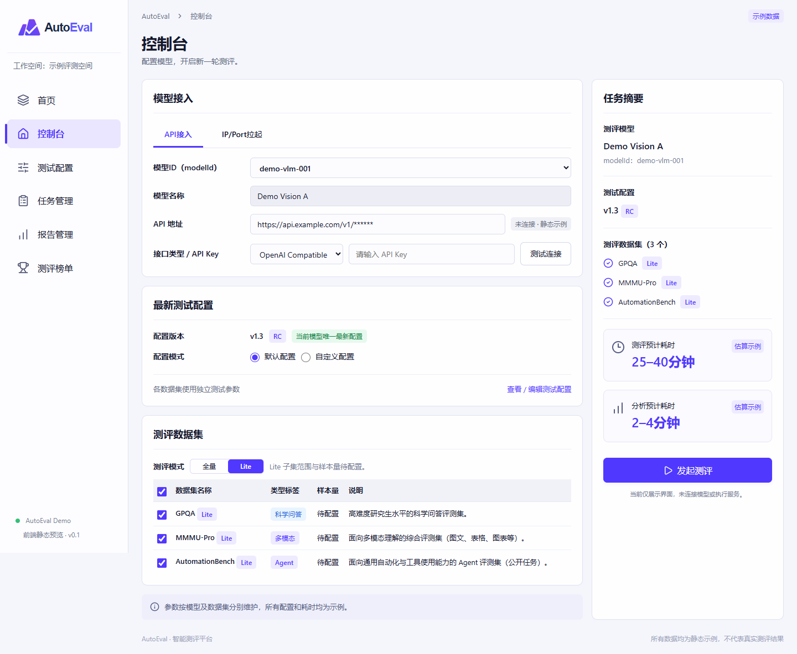
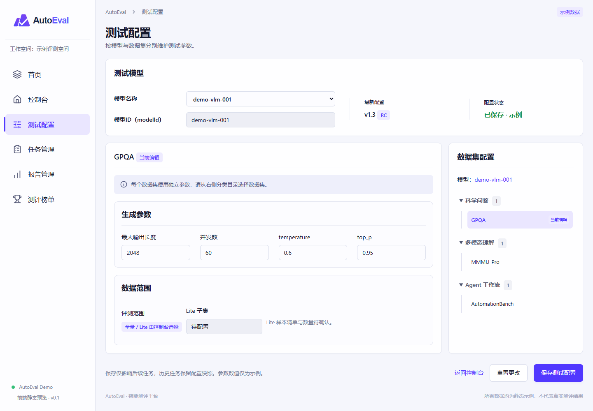
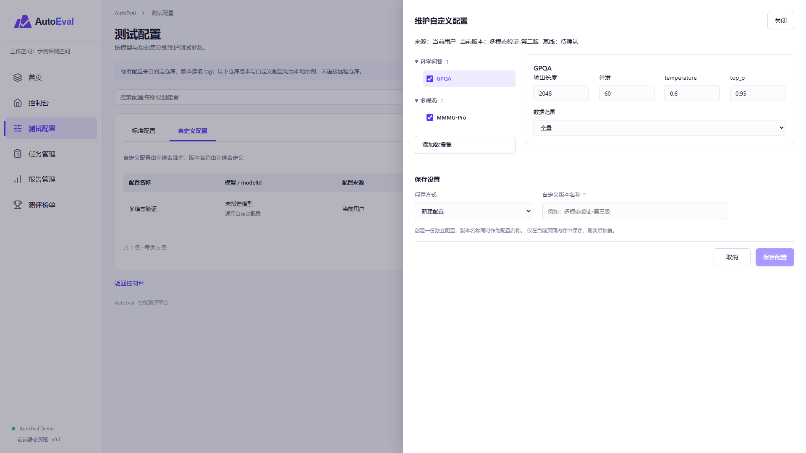
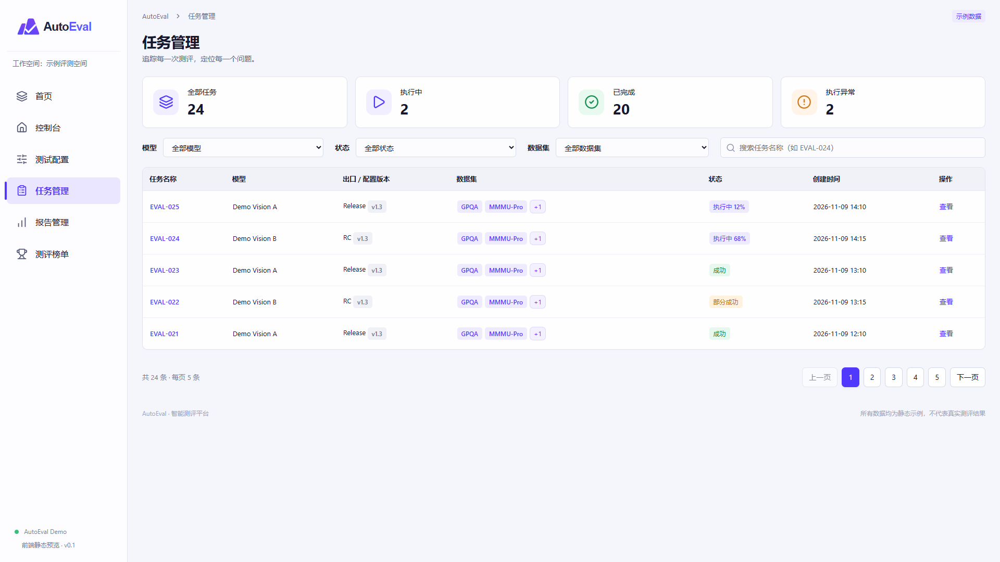
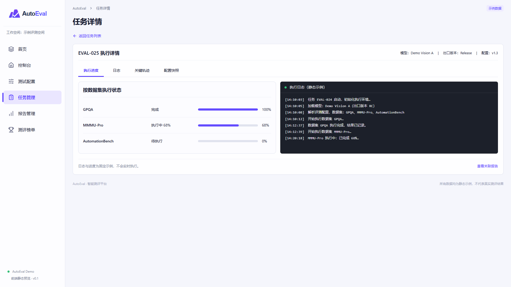
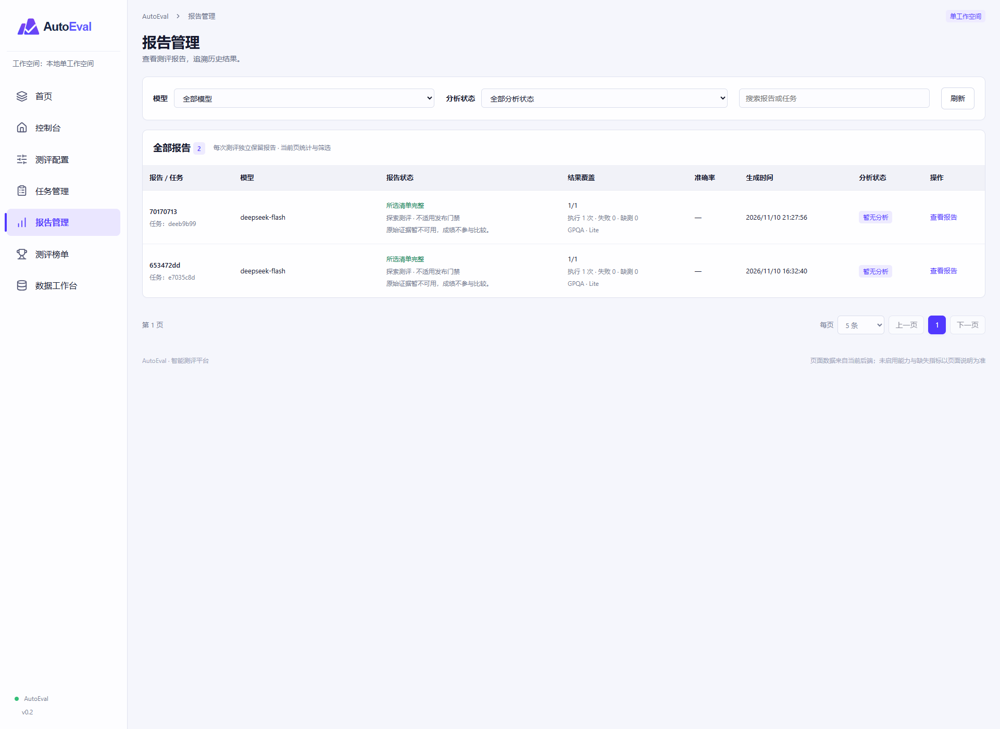
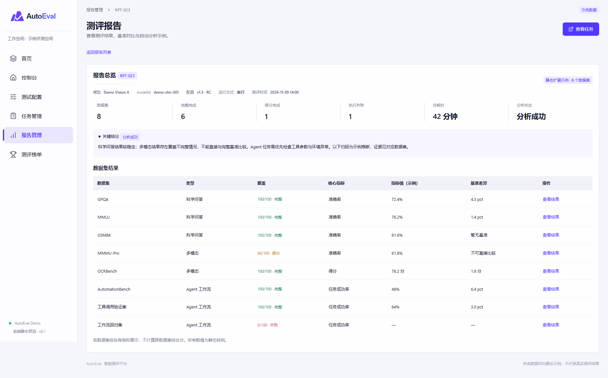
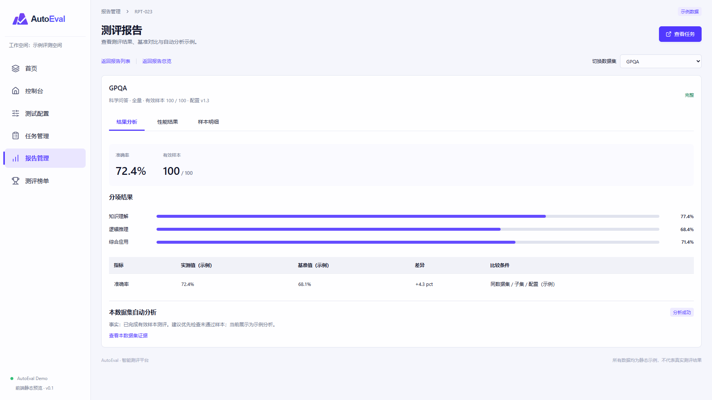
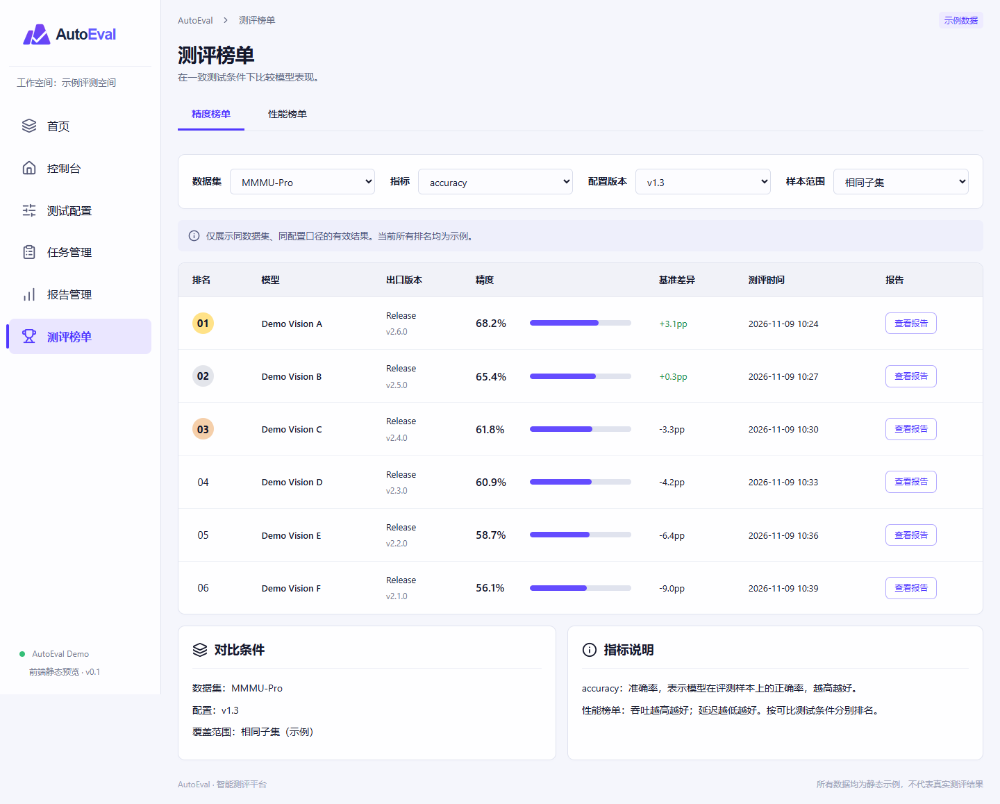

# AutoEval Demo

<p align="center">
  
</p>

AutoEval 智能测评平台的前端静态原型，用于预览模型接入、测试配置、任务管理、报告分析与模型榜单的页面和交互。

采用 React 19、TypeScript、Vite 6 和 Lucide React，包含六个一级菜单、独立任务详情及报告详情。使用正式 SVG 品牌素材，统一紫色主题、字体层级和响应式布局。

> 当前版本仅提供本地示例数据与前端交互。模型连接、测评执行、配置保存、报告生成和自动分析尚未接入后端；页面中的分数、耗时、日志、进度与分析结论均不代表真实测评结果。

## 页面预览

以下截图来自当前本地运行的静态 Demo，桌面视口为 1920 × 1080，截图保留页面完整内容。图中数据均为示例。

### 首页



### 控制台



### 测试配置



### 自定义配置维护



### 任务管理



### 任务详情



### 报告管理



### 报告总览



### 数据集报告详情



### 测评榜单



## 快速开始

准备 Node.js 22 或更高版本，以及 npm。在仓库根目录执行：

```sh
npm ci
npm run dev
```

打开终端输出的地址，默认是 [http://localhost:5173](http://localhost:5173)。若端口被占用，Vite 会尝试其他端口，以终端输出为准。

指定本地地址与端口：

```sh
npm run dev -- --host 127.0.0.1 --port 5173 --strictPort
```

## 常用命令

| 命令 | 用途 |
| --- | --- |
| `npm ci` | 按锁文件安装依赖 |
| `npm run dev` | 启动开发服务，支持热更新 |
| `npm run typecheck` | 执行 TypeScript 类型检查 |
| `npm run build` | 检查类型并构建至 `dist/` |
| `npm run preview` | 本地预览生产构建，默认端口 4173 |

预览构建产物：

```sh
npm run build
npm run preview
```

`preview` 用于本地检查，不作为生产部署服务。`node_modules/` 和 `dist/` 已加入 Git 忽略规则。

## 页面与交互

| 页面 | Hash 路径 | 当前支持 |
| --- | --- | --- |
| 首页 | `#home` | 平台概览与各功能入口 |
| 控制台 | `#console` | API / IP-Port 入口切换、标准 / 自定义配置、逐数据集全量 / Lite、串并行运行摘要 |
| 测试配置列表 | `#config` | 标准 / 自定义 Tab、分页列表、右上角仓库版本切换、多模型配置、查看 / 维护、新建与导入提示 |
| 配置查看 / 维护 | 列表内打开右侧抽屉 | 按数据集类型分组、多选、当前选中项参数、添加数据集、版本命名及保存设置 |
| 任务管理 | `#tasks` | 仅看我 / 其他人员、模型 / 状态 / 出口版本筛选、任务搜索、分页与独立详情 |
| 任务详情 | `#task/EVAL-025` | 执行进度、数据集级 case 日志及统计、只读原始配置快照、返回列表 |
| 报告管理 | `#reports` | 模型 / 出口版本 / 数据集 / 分析状态筛选、报告或任务搜索、列表分页 |
| 报告详情 | `#detail` | 默认总览及数据集结果列表、独立数据集详情、按需打开样本明细、内嵌基准与证据抽屉 |
| 测评榜单 | `#leaderboard` | 精度 / 性能切换、比较条件选择、吞吐 / 延迟指标切换与报告入口 |

### 列表展示规则

- 测试配置、任务和报告列表每页展示 5 条，支持页码、上一页和下一页。
- 修改筛选或搜索条件后回到第一页；任务、报告从详情返回列表时保留当前列表状态。
- 数据集列单行显示前两个名称，超出部分汇总为 `+N`。窄屏显示一个名称及剩余数量。
- 点击 `+N` 查看完整数据集列表，支持搜索、内部滚动和 Escape 关闭；长名称悬停可查看全名。
- 报告数据集筛选命中的名称优先展示。报告采用相同的 8 个扩展示例数据集以演示多数据集布局，切换数据集筛选不会改变报告数量；不代表关联任务真实产生了这些结果。

### 静态交互边界

- 连接测试、演示拉起、发起测评和重试分析仅显示提示，不调用真实服务；配置保存会更新当前页面内存，不写入服务端。
- 表单修改仅保留在页面内存中，刷新后恢复示例值；不会持久化配置或密钥。
- 任务状态与日志不会随时间更新。详情中的 case 日志、统计和结果为展示模板。
- 报告详情通过列表选择当前报告；报告 ID 暂未写入 URL，刷新或直接访问 `#detail` 会使用默认报告。
- 榜单条件及部分配置项用于交互展示，尚未实现完整的结果查询与可比性校验。
- Lite 子集和样本量等未确定信息显示“待配置”，示例参数不作为正式执行标准。

## 代码结构

```text
public/
  brand/                  正式横版 Logo、单色 Logo、应用图标
src/
  app/
    App.tsx               页面、Hash 导航、示例数据和交互组件
    Workflow.tsx          配置管理、共享编辑抽屉、控制台与数据集执行看板
    ReportView.tsx        多数据集报告总览、分类导航、结果和证据抽屉
    app.css               主题、字体层级、布局和响应式样式
  layouts/                基础布局组件预留
  components/             通用组件预留
  hooks/                  通用 Hooks 预留
  utils/                  工具函数预留
  types/                  类型定义预留
  assets/                 模块静态资源预留
  styles/global.css       全局样式入口说明
  main.tsx                React 挂载入口
index.html                HTML 入口与浏览器图标
vite.config.ts            Vite 配置
```

导航、列表和榜单位于 `App.tsx`，报告详情位于 `ReportView.tsx`，配置与测评流程位于 `Workflow.tsx`，后续接入后端时可按页面和领域拆分组件、数据类型及服务层。正式品牌素材位于 `public/brand/`，由所有页面共享。

## 验证状态

当前代码已通过 TypeScript 类型检查和 Vite 生产构建，尚未配置自动化测试脚本。

已使用本地 Chrome 无头模式采集以上页面与抽屉的实际截图，采集期间未发现页面运行时错误。完整交互验收及与设计原图的逐项视觉对照仍待完成；此前检查记录见 [design-qa.md](./design-qa.md)。构建和截图采集通过不等于业务验收通过。

默认无 Hash 路径时进入控制台；首页保留为一级菜单。

## 配置与测评流程

### 测试配置管理

- 通过“标准配置 / 自定义配置”Tab 切换，搜索框右侧提供新建和导入入口。
- 标准配置代表官方配置。右上角选择仓库 tag，一个版本下展示多个模型的测试配置；查看时全部参数只读。
- 自定义配置显示创建者及自定义版本名称。维护配置与控制台自定义配置共用右侧抽屉和参数编辑组件。
- 数据集按科学问答、多模态、Agent 工作流分组，树形展示，复选框与名称左对齐。
- 右侧只显示左侧当前选中数据集的参数，切换时保留其他数据集的更改。自定义配置中的 GPQA、MMMU-Pro、AutomationBench 均可编辑。
- 维护抽屉支持添加数据集、设置保存方式和版本名称。默认新建配置；保存到已有配置时创建新版本，名称冲突时不覆盖。
- 导入格式和校验规则尚未确定，当前入口提供说明；基线来源仍待确认。

### 控制台

- 默认展示标准配置，支持切换当前模型及标准配置版本（v1.3 / v1.2 / v1.1）。选择自定义模式时，下拉框展示已保存的自定义配置及版本，加载对应数据集、范围与参数。
- 每个数据集独立选择全量 / Lite；任务摘要逐项显示范围和预计耗时，无依据时显示“暂无可靠估算”。
- 运行方式位于任务摘要的配置信息下方，以“串行 / 并行”单选项展示，默认串行。
- 自定义抽屉支持多选数据集及独立参数编辑，保存返回控制台；取消不应用本次更改。
- 任务摘要显示测评预计总耗时：串行累加、并行取最长耗时；缺少可靠估算时不给出虚构时长，不包含排队及分析。

### 任务、报告与榜单

- 任务人员筛选为“仅看我 / 其他人员”，默认仅看我。切换后过滤本地示例任务并回到第一页。
- 任务详情包含独立任务总览：整体进度、全部数据集汇总、case 总数、判分通过 / 未通过 / 执行异常 / 待处理及报告状态。
- 下方按类型导航数据集，展示当前数据集统计。case 明细支持结果筛选、搜索和每页 5 条分页；点击查看通过右侧抽屉展示日志与输入响应。
- 配置快照为只读原始结构示例，凭据脱敏。模型答错与执行异常分别展示；已移除任务异常看板入口。
- 报告采用“先总览、再查看数据集”的两层结构。默认仅显示基本信息、覆盖统计、关键结论和数据集结果列表；点击查看进入独立详情视图，不再同时展开导航和结果。
- 数据集详情顶部将返回报告列表、返回报告总览并排展示，数据集切换器右对齐。结果分析、性能结果（仅支持时显示）与样本明细分开呈现，样本表格按需打开。
- 数据集详情按实际能力显示质量、性能结果与基准差异。Agent 数据集展示任务成功率、断言及工具调用；不再使用全局 Agent 结果页签，不计算跨数据集综合分。
- 部分覆盖显示不可直接比较；执行失败不填充指标；基准缺失显示暂无基准。样本明细支持过滤、搜索、分页和证据抽屉，报告级分析与当前数据集分析分别展示。
- 榜单标注受审批任务来源要求。正式异常定义、审批及准入流程待确认，未实现管理员审批。

配置、历史版本和结果均为本地样例。Lite 范围、并行上限、耗时口径、基线与审批规则未确定，不作为正式执行或验收标准。需求实现对照见 [workflow-requirements.md](./docs/workflow-requirements.md)。
