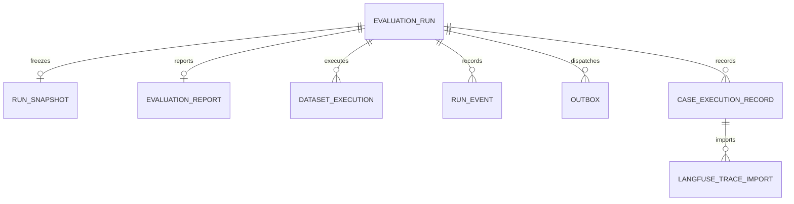

# AutoEval 数据契约与实体关系

## 接口与持久化边界

| 链路 | 输入 | 输出及持久化 |
| --- | --- | --- |
| 标准输入 | Bundle、Confirm、CompileInput | 标准输入版本与编译记录；校验、摘要与配置合并由 catalog.standard_compilation 提供 |
| 规划 | PlanInput、ProbeInput、CurveInput、ApplyInput | 规划作业、规划产物以及现有状态响应 |
| 统一提交 | SubmitTask 转换为 PlanInput | Envelope[SubmittedRun]；事务写入任务、冻结快照和 Outbox |
| 任务读取 | 任务 ID；列表筛选与偏移量 | TaskListEnvelope、任务详情与报告证据；动态正文沿用历史字段 |
| 报告与榜单 | 报告 ID、分页、榜单筛选 | 报告摘要、原始证据、评审记录和分组结果 |
| Trace | 任务 ID、既有重试入口 | 导入状态与可用链接；导入记录引用任务和样本尝试 |

HTTP Schema 以应用生成的 OpenAPI 为准。冻结快照与 Outbox 使用各自现有序列化格式，前端 API 类型沿用生成的契约。

## 实体关系

隔离 PostgreSQL 从空库升级至 0036_result_revisions 后，42 张业务表与 ORM 注册集合一致。下表来自 PostgreSQL 实际约束。子列唯一时，父记录至该子表的对应关系上限为一行。非空外键要求每条子记录关联一条父记录。

在快照 JSONB 中保存的目标、资源、配置、样本标识，以及报告或产物上的 S3 对象键属于应用层引用。下图展示任务主链路的物理关系。

| 子表及外键列 | 父表及目标列 | 可空 | 唯一 | 删除策略 |
| --- | --- | --- | --- | --- |
| `asset_version(asset_id)` | `asset(id)` | 否 | no | RESTRICT |
| `audit_event(run_id)` | `evaluation_run(id)` | 是 | 否 | RESTRICT |
| `case_execution_record(run_id)` | `evaluation_run(id)` | 否 | no | RESTRICT |
| `config_dataset_binding(config_item_id)` | `test_config_item(id)` | 否 | 是 | RESTRICT |
| `config_dataset_binding(manifest_id)` | `dataset_manifest(id)` | 否 | no | RESTRICT |
| `config_dataset_binding(profile_id)` | `evaluation_profile(id)` | 否 | no | RESTRICT |
| `connection_probe(target_id)` | `target_binding_version(id)` | 否 | no | RESTRICT |
| `dataset_execution(run_id)` | `evaluation_run(id)` | 否 | no | NO ACTION |
| `dataset_manifest(dataset_version_id)` | `asset_version(id)` | 否 | no | RESTRICT |
| `dataset_manifest(parent_id)` | `dataset_manifest(id)` | 是 | 否 | RESTRICT |
| `diagnostic_result(run_id)` | `evaluation_run(id)` | 否 | 是 | RESTRICT |
| `evaluation_profile(full_manifest_id)` | `dataset_manifest(id)` | 否 | no | RESTRICT |
| `evaluation_profile(lite_manifest_id)` | `dataset_manifest(id)` | 是 | 否 | RESTRICT |
| `evaluation_report(run_id)` | `evaluation_run(id)` | 否 | 是 | RESTRICT |
| `execution_cleanup(run_id)` | `evaluation_run(id)` | 否 | 是 | RESTRICT |
| `execution_lease(run_id)` | `evaluation_run(id)` | 否 | 是 | RESTRICT |
| `langfuse_trace_import(attempt_id)` | `case_execution_record(id)` | 否 | no | NO ACTION |
| `langfuse_trace_import(run_id)` | `evaluation_run(id)` | 否 | no | NO ACTION |
| `leaderboard_record(report_id)` | `evaluation_report(id)` | 是 | 否 | NO ACTION |
| `model_budget_request(budget_id)` | `model_budget_account(id)` | 否 | no | NO ACTION |
| `model_budget_request(run_id)` | `evaluation_run(id)` | 否 | no | NO ACTION |
| `model_config_binding(default_config_version_id)` | `test_config_version(id)` | 否 | no | RESTRICT |
| `model_config_binding(model_asset_id)` | `asset(id)` | 否 | 是 | RESTRICT |
| `outbox(run_id)` | `evaluation_run(id)` | 否 | no | RESTRICT |
| `report_analysis(report_id)` | `evaluation_report(id)` | 否 | 是 | RESTRICT |
| `report_analysis(run_id)` | `evaluation_run(id)` | 否 | no | RESTRICT |
| `resource_binding_version(provider_id)` | `resource_provider(id)` | 否 | no | RESTRICT |
| `result_archive_revision(parent_collection_id)` | `unified_result_collection(id)` | 否 | no | NO ACTION |
| `result_archive_revision(run_id)` | `evaluation_run(id)` | 否 | no | NO ACTION |
| `run_event(run_id)` | `evaluation_run(id)` | 否 | no | RESTRICT |
| `run_monitor_binding(run_id)` | `evaluation_run(id)` | 否 | no | NO ACTION |
| `run_monitor_snapshot(binding_id)` | `run_monitor_binding(id)` | 否 | no | NO ACTION |
| `run_snapshot(run_id)` | `evaluation_run(id)` | 否 | 是 | RESTRICT |
| `ssh_resource_binding(provider_id)` | `resource_provider(id)` | 否 | no | RESTRICT |
| `standard_input_compilation(input_id)` | `standard_input_version(id)` | 否 | no | RESTRICT |
| `standard_input_compilation(model_id)` | `asset(id)` | 是 | 否 | RESTRICT |
| `target_billing_binding(budget_id)` | `model_budget_account(id)` | 否 | no | NO ACTION |
| `target_billing_binding(price_id)` | `model_price_version(id)` | 否 | no | NO ACTION |
| `target_billing_binding(target_id)` | `target_binding_version(id)` | 否 | 是 | NO ACTION |
| `target_binding_version(model_version_id)` | `asset_version(id)` | 否 | no | RESTRICT |
| `test_config_item(config_version_id)` | `test_config_version(id)` | 否 | no | RESTRICT |
| `unified_output_artifact(run_id)` | `evaluation_run(id)` | 否 | no | RESTRICT |
| `unified_result_collection(run_id)` | `evaluation_run(id)` | 否 | no | RESTRICT |
